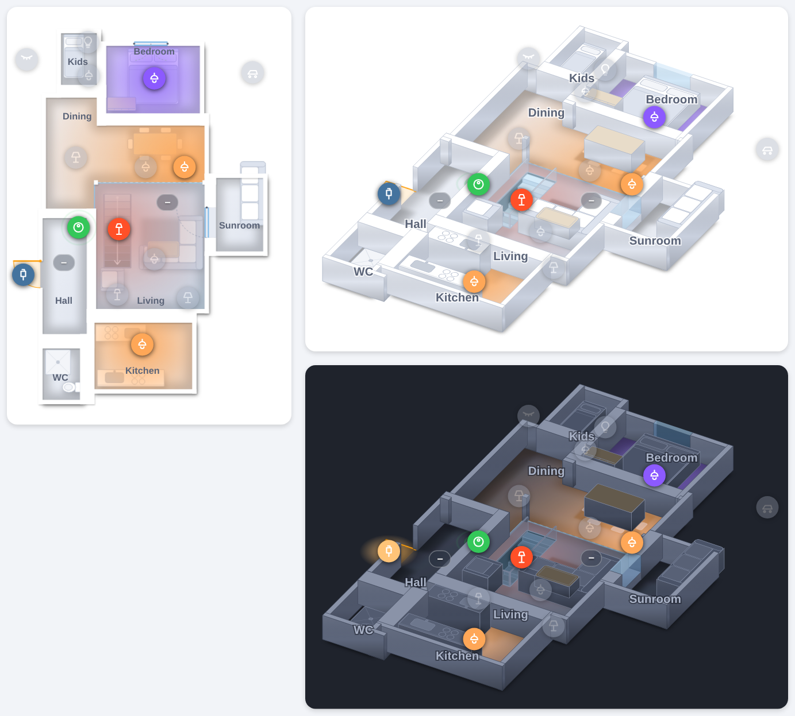

# Glow Floorplan Card

A floor plan card for Home Assistant where every room **glows in the real colour and brightness of its lamps**, rooms **pulse on motion**, robots show a **status ring**, and the plan switches between **day and night** with the sun. Everything is edited with **drag and drop** in the dashboard editor.



- No dependencies, no build step: one JavaScript file.
- No helper sensors: colour and brightness are read straight from each light.
- A lamp lights up the room it stands in. Drag it to another room and the glow follows.
- One layout, many dashboards: a second card can borrow the layout from another dashboard (`layout_from`).

## Installation

### Marketplace / HACS (custom repository)

1. Open **Marketplace** (HACS) → ⋮ → **Custom repositories**.
2. Add `https://github.com/DanielMikkelsen99/glow-floorplan-card` with type **Dashboard**.
3. Install **Glow Floorplan Card** and reload the browser.

### Manual

Copy `glow-floorplan-card.js` to `config/www/` and add it as a dashboard resource (`/local/glow-floorplan-card.js`, type *JavaScript module*).

## Getting started

Add a card, search for **Glow Floorplan Card**, and use the visual editor:

- **Enheder (Devices):** drag icons into place, click one to change entity, icon or tap action. **+ Måling** adds a value chip (for example a temperature).
- **Rum (Rooms):** click a room and drag its corners; the blue dot moves the name. Add or remove corners for L-shaped rooms.
- **Kortindstillinger (Card settings):** size of the canvas, theme, glow strength and a motion preview.

The code editor works too; everything is plain YAML.

## Configuration

```yaml
type: custom:glow-floorplan-card
size: [850, 1250]            # canvas units (width, height)
theme: auto                  # auto (follows sun.sun) | day | night
glow_strength: 1             # 0–1.5
rooms:
  - name: Living room
    points: [[260, 525], [597, 525], [597, 910], [260, 910]]
    label: [430, 880]        # optional position of the name
    motion:                  # the whole room pulses while any is on
      - binary_sensor.living_room_motion
    entity: light.living_room   # optional: tap the room to toggle it
openings:                    # optional: remove a wall between two rooms
  - line: [272, 525, 584, 525]
devices:
  - entity: light.table_lamp
    x: 440
    y: 755
    icon: mdi:ceiling-light
  - entity: switch.kids_lamp
    x: 242
    y: 105
    icon: mdi:airplane
    glow: true               # non-light entities can glow too
    glow_color: [255, 190, 120]
  - entity: vacuum.robot
    x: 215
    y: 660
    tap_action:
      action: navigate
      navigation_path: /dashboard/vacuum
  - entity: sensor.living_room_temperature
    type: label
    x: 480
    y: 585
```

### Editor

The editor has three tabs:

- **Enheder (Devices):** drag icons; click to edit.
- **Rum (Rooms):** drag a whole room (the icons inside move with it) or its corners. Corners snap horizontally and vertically to their neighbours and to other rooms, with guide lines. Hold **Alt** to move freely.
- **Åbninger (Openings):** drag the ends of an opening (they snap to walls and to 90°) or the dot in the middle to move it.
- **Møbler (Furniture):** pick a piece from the list, drag it into place (it snaps against walls), resize from the blue dot and rotate in 90° steps.
- **Døre & vinduer (Doors & windows):** draw doors and windows in the walls. The orange end is the hinge. Flip the hinge or the swing side with one click, choose one or two leaves, and link a sensor.

### Rooms

| Key | Description |
|---|---|
| `name` | Name shown in the room |
| `points` | Polygon corners `[x, y]` in canvas units |
| `label` | Position of the name (defaults to the centre) |
| `show_name` | `false` hides the name (or `show_names: false` on the card hides all) |
| `motion` | Motion sensors; the room pulses while one is on |
| `lights` | Extra lights that glow from the room centre (lamps placed as devices are picked up automatically) |
| `entity`, `tap_action`, `hold_action` | Make the room itself tappable |

### Devices

| Key | Description |
|---|---|
| `entity` | Any entity |
| `x`, `y` | Position in canvas units |
| `type` | `icon` (default) or `label` (shows the state as a chip) |
| `icon` | Overrides the icon |
| `size` | Icon size in px |
| `glow` | `true`/`false`; lights glow by default |
| `glow_color` | `[r, g, b]` for entities without colour |
| `color` | Fixed icon colour |
| `ring_states` | States that show a pulsing ring (vacuums and mowers have sensible defaults) |
| `tap_action`, `hold_action`, `double_tap_action` | Standard Home Assistant actions |
| `attribute`, `prefix`, `suffix`, `decimals` | For labels |

Lights glow inside the room they stand in. Lights outside every room (outdoor lamps) get a soft halo.

### Doors and windows

```yaml
doors:
  - type: door                 # door | window
    line: [100, 760, 100, 840] # first point is the hinge
    swing: -1                  # 1 (default) or -1: which side of the wall it opens to; 0 = fixed window
    leaves: 2                  # optional: double door / window
    sensor: binary_sensor.front_door  # optional
```

Without a sensor a door is drawn closed with a dashed arc that shows how it opens. With a sensor the leaf swings open (in orange) while the sensor reports open; tapping it opens the sensor's details.

### Furniture

```yaml
furniture:
  - type: double_bed     # single_bed, double_bed, sofa_2, sofa_3, sofa_corner, armchair,
    x: 362               # dining_table, coffee_table, dresser, cabinet, toilet, shower,
    y: 125               # kitchen_counter
    w: 150               # optional, defaults per type
    h: 165
    rotation: 90         # degrees, about the centre
```

More types: `stairs` (steps with an arrow pointing up; real steps in 3D), `washing_machine`, `dryer`, `desk` (with an office chair).

Furniture is static: it is drawn like an architect's plan in 2D and as blocks in 3D.

### 3D view

A **2D / 3D** switch sits in a row above the plan (never over it); the choice is remembered per browser. The 3D view shows the home from above at an angle, like a dollhouse in a game: low walls with doors and windows cut out, furniture as blocks, and the floors still glowing in the colour of the lamps.

```yaml
view: 3d                 # default view (2d if omitted)
view_toggle: true        # false hides the switch
view_3d:
  angle: 30              # rotation in degrees
  tilt: 0.58             # 0.3 (steep side view) … 0.9 (almost from above)
  wall_height: 70
```

### Robots

Vacuums and mowers pulse green while they work and red on error (`ring_color`, `error_color` to change).

### Floors

```yaml
default_floor: Stueetage
floors:
  - name: Kælder
    rooms: [...]
    devices: [...]
  - name: Stueetage
    rooms: [...]
    devices: [...]
    doors: [...]
    furniture: [...]
```

The card always opens on `default_floor` (pick it with **★ Standard** in the editor); add `remember_floor: true` to reopen the floor that was used last instead. With more than one floor the card shows floor buttons above the plan; a dot shows lights (yellow) or motion (blue) on another floor. In the editor, pick a floor, rename it, move it left/right, add or delete floors. A single plan without `floors` keeps working unchanged.

### Same plan on several dashboards

```yaml
type: custom:glow-floorplan-card
layout_from: dashboard-home   # url path of the dashboard that holds the plan
```

The card reads the first Glow Floorplan Card on that dashboard that does not itself use `layout_from`. Edit the plan there; every copy follows.

Card-level settings written next to `layout_from` override the shared plan for that copy only, for example a small version on a front page without room names:

```yaml
type: custom:glow-floorplan-card
layout_from: dashboard-home
show_names: false   # hide every room name in this copy
view: 2d
```

## Development

Open `test/harness.html` in a browser, or run the Playwright test:

```bash
node test/run.js
```

## License

MIT
